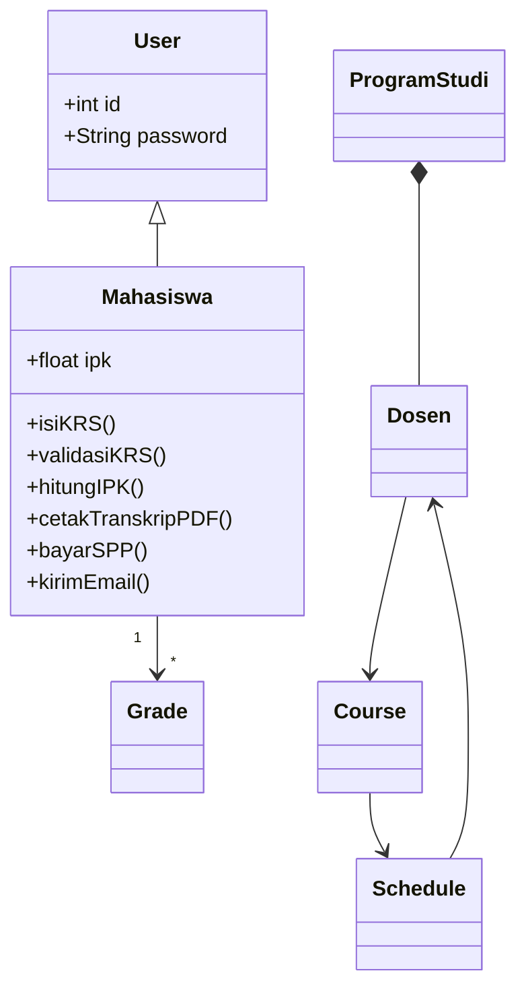
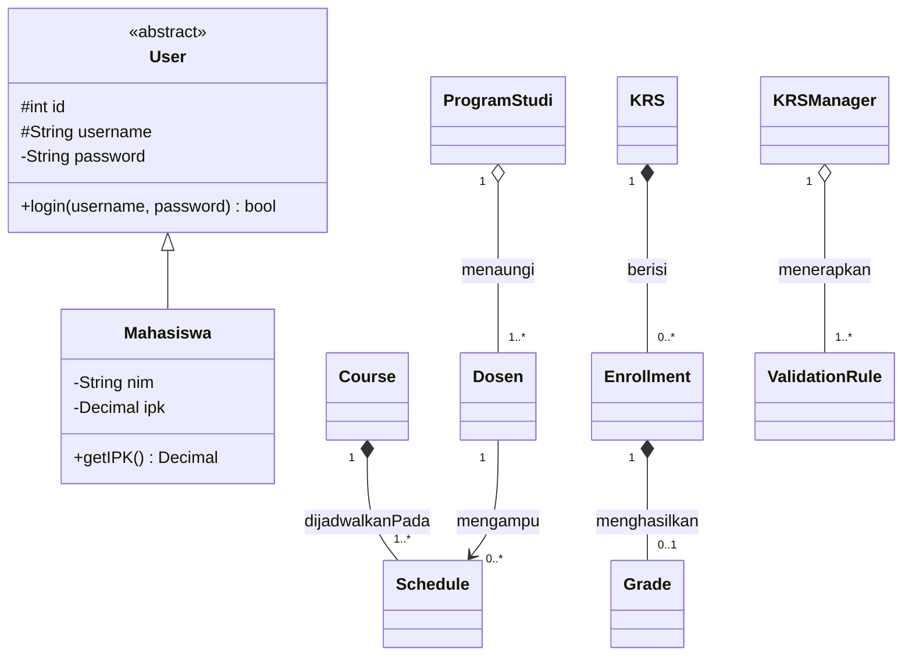

# AI Usage Log — SEVIMA-Mini (Minggu 1–12)

Catatan terstruktur ini mendokumentasikan seluruh penggunaan AI dari tahap perancangan arsitektur UML (**Minggu 1–2**) hingga implementasi modul PMB, KRS, Jadwal, Nilai, Transkrip, Keuangan, & Presensi (**Minggu 3–12**) pada mata kuliah **Pemrograman Berorientasi Objek untuk Sistem AI Agenik**. Seluruh proses mematuhi **AI-First Development Charter** (seluruh prompt, contoh data, dan fixture uji hanya memakai data *dummy* fiktif tanpa PII mahasiswa asli, tidak ada output AI yang dipakai tanpa validasi kritis, dan seluruh jejak iterasi terdokumentasi transparan).

---

## Bagian A — Minggu 1–2: Desain Sistem Akademis dengan UML Berbantuan AI

### 1. Kepatuhan AI-First Development Charter (Minggu 1–2)
1. **Yang Diizinkan:** Menggunakan LLM (Gemini / Claude / Mistral) dan Copilot IDE (Continue / Codeium) untuk mengeksplorasi domain, menghasilkan draf Mermaid UML, serta melakukan audit prinsip SOLID—dengan syarat seluruh desain dipahami, divalidasi relasinya, dan disesuaikan sendiri.
2. **Yang Dilarang:** Menyalin (*copy-paste*) diagram AI mentah tanpa memeriksa *visibility*, kardinalitas, arah relasi, dan *alternate flow*; memasukkan data pribadi/rahasia (NIK, nilai asli mahasiswa) ke prompt; serta menghapus riwayat iterasi AI.
3. **Bukti Wajib:** Log 7 prompt terbaik beranatomi lengkap, tabel perbandingan hasil AI awal vs revisi manual (*before–after*) beserta alasan teknisnya, cuplikan revisi kode Mermaid, serta refleksi **OPAR** siap uji lisan (*viva* tanpa AI).

---

### 2. 7 Prompt Terbaik Minggu 1–2 (Anatomi 5 Unsur: Role, Konteks, Komponen, Constraint, Format)

| No | Fokus Desain | Prompt Buruk (Awal) vs Prompt Terbaik (Iterasi Final) | Hasil & Nilai Tambah Iterasi |
| :--- | :--- | :--- | :--- |
| **1** | **Class Diagram Inti + Hierarki User** | **Buruk:** *"Buatkan class diagram sistem kampus."* (AI menebak entitas `Kantin`/`Gedung`, atribut *public* semua, tanpa `Payment`). **Terbaik:** *"`#role` Anda adalah arsitek OOP. `#konteks` Sistem akademis SEVIMA-Mini (modul PMB, KRS, Jadwal, Nilai, SPP, Presensi). `#komponen` Buat `User <<abstract>>` (turunan: `CalonMahasiswa`, `Mahasiswa`, `Dosen`, `Admin`), `ProgramStudi`, `Course`, `KRS`, `Enrollment`, `Schedule`, `Grade`, dan `Payment`. `#constraint` Terapkan Single Responsibility, wajib visibility `+`/`-`/`#` (`-password` & `-ipk` private), pisahkan composition vs aggregation, serta tulis kardinalitas. `#format` Output kode Mermaid `classDiagram` saja tanpa penjelasan panjang."* | Menghilangkan class halusinasi di luar kebutuhan, mengunci enkapsulasi `-password` dan `-ipk`, serta memaksa AI menulis kardinalitas eksplisit (`1`, `0..1`, `0..*`, `1..*`). |
| **2** | **Audit & Refactor Prinsip SOLID (Anti God-Object)** | *"`#role` Sebagai senior software architect, audit `classDiagram` berikut terhadap prinsip SOLID (khususnya SRP, OCP, dan DIP). `#konteks` Saat ini `Mahasiswa` memiliki method `isiKRS()`, `validasiKRS()`, `hitungIPK()`, `generateTranskripPDF()`, dan `kirimEmailTagihan()`, serta terdapat ketergantungan `Course -> Schedule -> Dosen -> Course`. `#komponen` Refactor dengan memecah ke service `PMBService`, `NIMFactory`, `KRSManager`, `ValidationRule <<interface>>` (5 aturan), `TranscriptService`, dan `NotificationObserver <<interface>>`. `#constraint` Tidak boleh ada class dengan >10 method (bebas god object) dan bebas circular dependency. `#format` Kode Mermaid `classDiagram`."* | Memecah *god object* menjadi kelas kecil terfokus (maks 5 method/class), memperkenalkan pola **Strategy/CoR**, **Factory**, & **Observer**, serta memutus siklus dependensi menjadi DAG asiklik. |
| **3** | **Validasi Relasi UML (Composition vs Aggregation & M2M)** | *"`#role` Anda adalah reviewer desain UML. `#konteks` Validasi seluruh relasi antar-class pada `classDiagram` SEVIMA-Mini. `#komponen` Periksa: (a) relasi `CalonMahasiswa` ke `Mahasiswa` saat diterima PMB, (b) relasi `Mahasiswa` dan `Course` melalui `Enrollment`, (c) pelekatan `Grade`, dan (d) `ProgramStudi` ke `Dosen`/`Mahasiswa`. `#constraint` Gunakan uji siklus hidup: jika wadah dihapus apakah bagian ikut mati (`*--` composition vs `o--` aggregation), dan uji 'is-a' untuk inheritance. `#format` Perbaiki kode Mermaid dan jelaskan alasannya dalam tabel ringkas."* | Mengubah `CalonMahasiswa` ke `Mahasiswa` dari inheritance keliru menjadi asosiasi konversi `1 --> 0..1` lewat `NIMFactory`; memecah M2M via `Enrollment`; memindahkan `Grade` ke `Enrollment *-- Grade`; membedakan `ProgramStudi o-- Dosen` vs `KRS *-- Enrollment`. |
| **4** | **Use Case Diagram 5 Aktor (`«include»` & `«extend»`)** | *"`#role` Anda adalah analis sistem. `#konteks` Buat Use Case Diagram sistem akademis SEVIMA-Mini lintas 6 modul (PMB, KRS, Jadwal, Nilai/Transkrip, SPP, Presensi QR). `#komponen` Aktor eksternal: `Calon Mahasiswa`, `Mahasiswa`, `Dosen`, `Admin`, dan `Sistem PMB`. Use case inti: Daftar Kuliah, Verifikasi PMB, Generate NIM Otomatis, Isi KRS, Validasi KRS, Cek Tunggakan SPP, Approve/Revisi KRS, Kirim Notifikasi Revisi, Kelola Jadwal, Deteksi Bentrok, Input Nilai, Validasi Presensi >= 75%, Catat Audit Trail, Generate Transkrip, Hitung IPS/IPK, Bayar SPP, Hitung Denda, Kelola Tagihan, Buat/Scan QR & Validasi Token. `#constraint` Tempatkan seluruh aktor di luar batas sistem, dan arahkan panah `«include»` (Base -> Included) serta `«extend»` (Extending -> Base) sesuai standar UML. `#format` Mermaid `flowchart LR`."* | Memastikan seluruh 5 aktor berada di luar `subgraph SistemAkademis` serta mengoreksi arah panah `«extend»` pada `Kirim Notifikasi Revisi -.-> Approve / Revisi KRS` dan `Hitung Denda Keterlambatan -.-> Bayar Tagihan SPP`. |
| **5** | **Sequence Diagram Proses PMB & Generate NIM Atomik** | *"`#role` Sebagai arsitek backend OOP, buat sequence diagram skenario Proses Pendaftaran Mahasiswa Baru (PMB). `#konteks` Alur registrasi `CalonMahasiswa` hingga verifikasi `Admin` di SEVIMA-Mini. `#komponen` Participant: `CalonMahasiswa`, `Admin`, `PMBService`, `NIMFactory`, `Database`, `NotificationService`. `#constraint` Wajib gunakan `autonumber` dan blok `alt` lengkap untuk: format input invalid (`400`), email duplikat (`409`), pendaftar tidak ada (`404`), konflik status `rejected` (`409`), idempotency `already approved` (`200`), overflow nomor >9999 (`400`), serta rollback transaksi saat gagal commit. `#format` Mermaid `sequenceDiagram`."* | Menggantikan skenario *happy path* tunggal menjadi alur transaksional aman berbasis *database lock* dan `NIMFactory` lengkap dengan seluruh jalur error & idempotency. |
| **6** | **Sequence Diagram Validasi KRS & Prasyarat + Review PA** | *"`#role` Sebagai arsitek sistem, buat sequence diagram Validasi KRS dengan pengecekan prasyarat di SEVIMA-Mini. `#konteks` Mahasiswa submit KRS yang memvalidasi tunggakan SPP, duplikasi, prasyarat lulus (`>= 2.0`), batas 24 SKS, dan bentrok interval jadwal, lalu diproses Dosen PA. `#komponen` Participant: `Mahasiswa`, `KRSManager`, `ValidationRule Chain`, `Database`, `NotificationService`, `Dosen PA`. `#constraint` Gunakan `autonumber`, tampilkan `alt` untuk blokir tunggakan SPP (`403`), gagal validasi (`400`), konflik versi *optimistic lock* (`409`), status `Pending Approval`, serta blok `opt` review PA (`403`/Approve/Revisi). `#format` Mermaid `sequenceDiagram`."* | Menyinkronkan nama method dengan Class Diagram (`submitKRS`, `validate`, `ubahStatus`, `approveKRS`, `reviseKRS`, `kirimNotifikasi`) dan mengunci *alternate flow* lengkap agar mudah diturunkan ke Chain of Responsibility di Minggu 5–6. |
| **7** | **Sequence Diagram Presensi Scan QR Code (Prompt Pack)** | *"`#role` Anda adalah arsitek sistem akademis. `#konteks` Skenario bonus presensi mahasiswa scan QR code di SEVIMA-Mini. `#komponen` Participant: `Mahasiswa`, `PresensiService`, `Database`, `NotificationService`, `Dosen`. `#constraint` Validasi token JWT (`401`), enrollment kelas (`403`), kecocokan `jti` & hari jadwal kuliah (`400`), radius geofence (`400`), duplikasi scan (`409`), catat status hadir/terlambat, dan kirim notifikasi ke Dosen. `#format` Mermaid `sequenceDiagram` dengan `autonumber`."* | Menambahkan lapisan *error handling* lengkap (`alt` 5 cabang error) di atas Prompt Pack #3 tugas sehingga siap diimplementasikan di Modul Presensi Minggu 12. |

---

### 3. Perbandingan Hasil AI Awal vs Revisi Manual (*Before–After*) & Alasan Revisi

| No | Komponen / Aspek | Output AI Awal (*Before*) | Revisi Manual Mahasiswa (*After*) | Mengapa Revisi Diperlukan? |
| :--- | :--- | :--- | :--- | :--- |
| **1** | **Visibility Modifier & Enkapsulasi** | `+String password`, `+float ipk`, dan `+String status` dibuat *public* (`+`). | `-String password` dan `-Decimal ipk` dibuat *private* (`-`), `#id`/`#username`/`#nama`/`#email` dibuat *protected* (`#`), akses IPK melalui `+getIPK()` & `TranscriptService`. | Pelanggaran prinsip **Encapsulation**: jika `ipk` atau `password` bersifat *public*, bagian program mana pun bisa mengubah `mahasiswa.ipk = 4.0` secara langsung tanpa perhitungan nilai sah atau membaca *password* langsung. |
| **2** | **Hierarki `User` & Konversi `CalonMahasiswa`** | `class User` konkret dan `Mahasiswa` mewarisi `CalonMahasiswa` (atau `CalonMahasiswa` diubah tipenya saat diterima). | `User <<abstract>>` dengan 4 subclass sejajar (`CalonMahasiswa`, `Mahasiswa`, `Dosen`, `Admin`) + asosiasi konversi `CalonMahasiswa "1" --> "0..1" Mahasiswa` lewat `NIMFactory.createMahasiswa()`. | Dalam OOP, **objek tidak dapat berganti class** di *runtime*, dan `Mahasiswa` bukanlah spesialisasi (*is-a*) dari `CalonMahasiswa` karena tidak butuh `statusSeleksi` terus-menerus. Selain itu, tidak ada user tanpa peran sehingga `User` wajib `<<abstract>>`. |
| **3** | **Anti *God Object* (SOLID — SRP & DIP)** | `class Mahasiswa` berisi 15–22 method (`daftarPMB`, `isiKRS`, `validasiKRS`, `hitungIPK`, `cetakTranskripPDF`, `bayarSPP`, `kirimNotifikasi`). | `Mahasiswa` fokus pada data diri & aksi dasar (`<= 4` method). Tanggung jawab dipisah ke `PMBService`, `NIMFactory`, `KRSManager`, `ValidationRule <<interface>>`, `TranscriptService`, dan `NotificationObserver <<interface>>`. | *God Object* melanggar **Single Responsibility Principle (SRP)**: perubahan format PDF transkrip atau aturan SKS akan memaksa perubahan pada class `Mahasiswa`, membuatnya rapuh, sulit diuji, dan melanggar *Dependency Inversion*. |
| **4** | **Penghapusan *Circular Dependency*** | `Course` memanggil `Schedule`, `Schedule` memanggil `Dosen`, dan `Dosen` menyimpan daftar `Course` (`Course -> Schedule -> Dosen -> Course`). | Graf dependensi dibuat **asiklik (DAG)**: `Course "1" *-- "1..*" Schedule` dan `Dosen "1" --> "0..*" Schedule` (tanpa edge balik dari `Course` ke `Dosen` atau `Schedule` ke `Course`). | Ketergantungan melingkar (*circular dependency*) menyebabkan modul tidak bisa diuji secara terisolasi, memicu masalah inisialisasi/import siklik, dan meningkatkan *coupling*. |
| **5** | **Dekomposisi M2M & Pelekatan `Grade`** | Relasi langsung `Mahasiswa "*" -- "*" Course` dan `Mahasiswa "1" --> "0..*" Grade`. | Dipecah memakai class perantara `Enrollment` (`KRS "1" *-- "0..*" Enrollment` dan `Enrollment "0..*" --> "1" Course`), serta `Enrollment "1" *-- "0..1" Grade`. | Relasi M2M langsung tidak punya tempat menyimpan `semester` dan `status` pengambilan MK. Nilai (`Grade`) selalu melekat pada satu pengambilan mata kuliah oleh satu mahasiswa di semester tertentu (`Enrollment`), bukan langsung ke `Mahasiswa`. |
| **6** | **Composition (`*--`) vs Aggregation (`o--`)** | AI menukar `ProgramStudi *-- Dosen` (composition) dan `KRS o-- Enrollment` (aggregation). | Dibalik menjadi `ProgramStudi "1" o-- "1..*" Dosen` (aggregation) dan `KRS "1" *-- "0..*" Enrollment` (composition). | Uji siklus hidup (*lifecycle*): jika `ProgramStudi` ditutup, `Dosen`/`Mahasiswa` tetap eksis dan bisa pindah prodi (**Aggregation**). Sebaliknya, jika satu `KRS` dihapus, seluruh baris `Enrollment` dan `Grade` di dalamnya kehilangan makna dan ikut terhapus (**Composition**). |
| **7** | **Struktur & Arah Panah Use Case Diagram** | Aktor `Sistem PMB` diletakkan di dalam kotak sistem; arah panah `«extend»` ditarik dari Base ke Extending (`Approve KRS -.-> Notifikasi Revisi`). | Seluruh 5 aktor diletakkan di **luar** `Sistem Akademis SEVIMA-Mini`; panah `«include»` ditarik `Base -.-> Included` dan panah `«extend»` ditarik `Extending -.-> Base` (`Kirim Notifikasi Revisi -.-> Approve / Revisi KRS`, `Hitung Denda Keterlambatan -.-> Bayar Tagihan SPP`). | Sesuai spesifikasi UML, aktor bersifat eksternal terhadap sistem. Pada relasi `«extend»`, use case tambahanlah yang menempel/menunjuk ke use case dasar (*conditional extension*), kebalikan dari arah `«include»`. |
| **8** | **Sequence Diagram: *Alternate Flow* & Sinkronisasi** | AI hanya menggambar alur sukses (*happy path* tanpa blok `alt`), langsung mengubah status tanpa lock DB atau cek tunggakan SPP, dan nama method berbeda dari Class Diagram. | Menambahkan frame `alt`/`opt` pada ketiga sequence diagram (`400`, `401`, `403`, `404`, `409`, `rollback`), menjaga keseimbangan `activate`/`deactivate`, serta menyinkronkan nama method tepat dengan Class Diagram. | Sequence diagram tanpa *alternate flow* gagal memodelkan kegagalan validasi bisnis (prasyarat tidak lulus, >24 SKS, bentrok, QR expired, tunggakan SPP) dan risiko *race condition* transaksi database. |

#### Cuplikan Before–After Revisi Diagram (Class Diagram & Sequence Diagram)

**1. Before (Output AI Awal — God Object, Public Password, Circular, Salah Relasi):**

**2. After (Revisi Manual — Abstract User, Encapsulation, Composition vs Aggregation, SOLID DAG):**

---

### 4. Siklus OPAR Minggu 1–2 (Fase Desain UML)
- **Observe:** Output awal AI untuk UML sistem akademis sering mengandung 5 cacat desain utama: *public* pada atribut sensitif (`password`, `ipk`), *god object* (`Mahasiswa` menampung validasi KRS hingga cetak PDF), *circular dependency* (`Course <-> Schedule <-> Dosen`), tertukarnya *composition* vs *aggregation* dan arah `«extend»`, serta sequence diagram tanpa *alternate flow*.
- **Plan:** Menyusun prompt terstruktur 5 unsur (*Role, Konteks, Komponen, Constraint, Format*) secara bertahap (domain dulu baru refactor SOLID), mengaudit setiap hasil dengan uji *is-a*, uji siklus hidup (*lifecycle*), dan graf dependensi asiklik (DAG), lalu menyinkronkan penamaan ke seluruh 5 file diagram di `diagrams/`.
- **Act:** Menghasilkan 5 diagram Mermaid sinkron (`class-diagram.mmd`, `usecase-diagram.mmd`, `sequence-pmb.mmd`, `sequence-krs.mmd`, `sequence-presensi.mmd`), menulis [docs/ADR-architecture-decisions.pdf](../docs/ADR-architecture-decisions.pdf), menyusun laporan [docs/Final-UML-diagram.pdf](../docs/Final-UML-diagram.pdf), dan mendokumentasikan 7 prompt terbaik + perbandingan *before–after*.
- **Reflect:** Investasi waktu pada validasi relasi, pemecahan *god object* (`ValidationRule`, `NIMFactory`, `NotificationObserver`), dan penambahan *alternate flow* pada Minggu 1–2 langsung menjadi cetak biru arsitektur bersih saat implementasi Python/SQLAlchemy/FastAPI pada Minggu 3–12—terbukti dari ketiadaan perubahan struktur konseptual besar saat membangun Chain of Responsibility, State Machine, Observer Outbox, Dual Transcript Renderer, Billing SPP, dan Presensi QR.

---

## Bagian B — Minggu 3–12: Implementasi Modul SEVIMA-Mini

## Log Terstruktur per Minggu & Fitur

| Minggu | Fitur | Tujuan | LLM / Tool | Prompt Kunci | Kode AI Awal | Revisi Manual | Uji & Hasil |
| :--- | :--- | :--- | :--- | :--- | :--- | :--- | :--- |
| Minggu 3 | Skema DB & Migrasi Alembic (`0001`) | Menerjemahkan Class Diagram (`program_studi`, `jalur_masuk`, `calon_mahasiswa`) & 5 constraint DB dengan rollback aman. | Mistral (HF Inference) & Antigravity | *"Desain skema database PMB SQLAlchemy 2.0 (`DeclarativeBase`, `Mapped`) untuk `program_studi`, `jalur_masuk`, `calon_mahasiswa` dengan 5 constraint (unique email/NIM, panjang HP, format email, status enum `create_constraint=True`, FK) serta migrasi Alembic `upgrade`/`downgrade`."* | Menggunakan gaya lama `declarative_base()`, mengusulkan `REGEXP` pada `CHECK constraint` (tidak didukung SQLite bawaan), dan belum menyalakan `PRAGMA foreign_keys=ON`. | Menyesuaikan ke `DeclarativeBase` + `Mapped[...]`, mengganti regex DB dengan `CheckConstraint` SQL standar + regex penuh di Pydantic, serta menyalakan `PRAGMA foreign_keys=ON` di `database.py` dan `alembic/env.py`. | `alembic upgrade head`, `downgrade base`, & `seed.py` (2x idempotent) LULUS; 5 tes constraint DB langsung di `pytest` LULUS. |
| Minggu 3 | REST API Register, Status, & Stats + Validasi | Menyediakan endpoint `/register`, `/status/{id}`, `/stats` dengan arsitektur router tipis -> service dan respons `400` untuk error validasi. | Mistral & Codeium | *"Buat router FastAPI tipis dan service layer dengan Pydantic v2 untuk `/api/pmb/register` (201/400/409), `/status/{id}` (200/404), dan `/stats` (200). Ubah `RequestValidationError` FastAPI menjadi HTTP 400 dan cegah kebocoran `alamat`/`tanggal_lahir` di response registrasi."* | FastAPI mengembalikan `422` pada validasi Pydantic; skema respons awal hampir memakai satu model DTO untuk semua field; belum ada fallback `IntegrityError` di `register()`. | Menambahkan handler `RequestValidationError -> 400`, memisahkan `RegisterRequest` dan `PendaftarOut`, menambahkan normalisasi `.lower()` email, serta menangkap `IntegrityError -> 409`. | Tes registrasi valid (`201`), duplikat email beda kapital (`409`), fallback `IntegrityError`, format HP/email invalid (`400`), & `/stats` LULUS. |
| Minggu 4 | Refactor OOP `PMBService`, Endpoint `approve`/`reject`, & Swagger Docs | Menyelaraskan alur bisnis ke kelas OOP `PMBService`, membedakan HTTP `409 Conflict` vs `400 Bad Request`, serta melengkapi dokumentasi OpenAPI. | Mistral & Antigravity | *"Refaktor aturan bisnis PMB menjadi kelas OOP `PMBService`. Pada `PUT /approve/{id}` dan `PUT /reject/{id}`, bedakan HTTP `404` (tidak ditemukan), `409 Conflict` (konflik transisi status seperti bukan `pending`), dan `400` (data prodi tidak valid untuk NIM). Lengkapi `responses={...}` pada Swagger OpenAPI."* | Versi awal memetakan seluruh penolakan status (`rejected -> approve`, `approved -> reject`) ke `400`, fungsi masih berbentuk module-level tanpa kelas service, dan decorator FastAPI belum mendokumentasikan error `400`/`404`/`409`. | Membungkus service ke `class PMBService`, menambahkan `DataNIMTidakValid` (`400`), memetakan `StatusTidakValid` ke `409 Conflict`, serta menambahkan `responses={...}` lengkap di `app/routers/pmb.py`. | Verifikasi Swagger `/docs`, ReDoc `/redoc`, dan `/openapi.json` (HTTP `200`, seluruh kode `400`/`404`/`409` terdokumentasi) LULUS. |
| Minggu 4 | NIM Generator Anti Race Condition (`nim_counter`), `format_nim()`, & Test Suite | Mengganti Python lock dengan mekanisme transaksi database atomik (`nim_counter`), memisahkan helper murni `format_nim()`, dan menembus coverage >= 80%. | Antigravity & Codeium | *"Refactor `generate_nim()` agar TIDAK memakai `threading.Lock()`. Gunakan tabel counter `nim_counter` (`tahun`, `kode_prodi`, `last_number`), migrasi Alembic `0002`, `SELECT ... FOR UPDATE` (`with_for_update()`), `db.flush()` tanpa `commit()` di generator, `BEGIN IMMEDIATE` + `UNIQUE` + retry di `PMBService.approve()`, dan helper murni `format_nim()` yang dikunci regex test."* | AI pada iterasi Minggu 3 sempat menyarankan `threading.RLock()` di memori Python dan query `MAX(nim) + 1`, serta memanggil `commit()` terlalu cepat yang berisiko memisahkan increment counter dari update status mahasiswa. | **Revisi arsitektur total:** menghapus `threading.Lock()` seluruhnya; menambah tabel `nim_counter` (`0002_tabel_nim_counter.py`); memakai `with_for_update()` + `BEGIN IMMEDIATE` (`PRAGMA busy_timeout=30000`) + `db.flush()` + `UNIQUE` + retry 3x; mengekstrak `format_nim()` (termasuk cek overflow `> 9999`); serta mendokumentasikan pilihan format `2025001-0001` di ADR-005. | **30/30 tes `pytest` LULUS** (termasuk 5 thread paralel + 2 thread idempotency paralel & uji rollback atomik), coverage **96.75% (97%)**, lolos `--cov-fail-under=80`. |
| Minggu 5 | Skema KRS (`matakuliah`, `krs`, `krs_detail`, `prerequisite`, `skala_nilai`) & Migrasi `0003` | Menyelesaikan relasi M2M mahasiswa–matakuliah (dua tingkat) dan *self-referencing* prasyarat beserta constraint SQL & migrasi rollback aman. | Antigravity & Codeium | *"Dengan Python 3.10 dan SQLAlchemy 2.0 `Mapped`, buat model `SkalaNilai`, `MataKuliah`, tabel asosiasi `prerequisite`, `KRS` (`UNIQUE nim+semester`), `KRSDetail` (`UNIQUE krs_id+kode_mk`, cascade `delete-orphan`) serta migrasi `0003_tabel_krs.py` dan seeding dummy."* | AI rawan membalik arah `primaryjoin`/`secondaryjoin` pada *self-referencing* M2M `prerequisite` dan membandingkan nilai huruf sebagai string (`nilai >= 'C'`) atau memakai `Boolean`/teks bebas untuk status. | Menetapkan `primaryjoin=(kode_mk == prerequisite.c.kode_mk)` dan `secondaryjoin=(kode_mk == prerequisite.c.kode_prasyarat)` lalu memverifikasinya di test (`IF102.prasyarat == [IF101]`), menambah tabel bobot `SkalaNilai` + `KRSStatus` enum `create_constraint=True`, serta 3 CHECK constraint jadwal/SKS. | `alembic upgrade head`, `downgrade -1`, `upgrade head`, `seed.py` x2 LULUS; seluruh test constraint CHECK/UNIQUE/FK di `tests/test_krs.py` LULUS. |
| Minggu 5 | Chain of Responsibility Validators, Query `NOT EXISTS` + `EXPLAIN`, & `KRSManager` + API | Membangun 4 validator (`Duplicate`, `SKS`, `Prerequisite`, `Conflict`), `KRSManager` terkunci transaksi, query prasyarat terindeks, dan router `/api/krs/*`. | Antigravity & Mistral | *"Implementasikan Chain of Responsibility (`ValidationResult`, `KRSContext`, `Validator(ABC)` + `build_chain`) untuk validator KRS (`Duplicate -> SKS -> Prerequisite -> Conflict`), rumus irisan interval `<` (kuliah bersambung boleh), query prasyarat `NOT EXISTS` dengan bobot `skala_nilai >= 2.0`, dan `KRSManager` (add/remove/validate) lengkap dengan lock baris & router `/api/krs/*`."* | Implementasi naif sering menyamakan bentrok dengan `a.jam_mulai == b.jam_mulai` saja (gagal pada jadwal bertumpuk sebagian), lupa membungkus baca-validasi-tulis `add_course` dalam transaksi terkunci, atau tidak memisahkan mode *fail-fast* (`add_course`) vs *collect-all* (`validate_krs`). | Mengganti cek bentrok ke `a.hari == b.hari and a.jam_mulai < b.jam_selesai and b.jam_mulai < a.jam_selesai`; membuktikan eliminasi `SCAN` lewat `EXPLAIN QUERY PLAN`; memakai `with_for_update()` + `BEGIN IMMEDIATE` di `KRSManager`; membuat stub `submit_krs`/`approve_krs` untuk Minggu 6; serta mencatat trade-off di ADR-006/007. | **41/41 tes `pytest` LULUS** (termasuk skenario concurrency "2 tab, 1 detik, 27 SKS"), coverage **95.83% (96%)**, `EXPLAIN QUERY PLAN` memakai index penuh, & endpoint `/api/krs/*` HTTP `200`/`201`/`400`/`404`/`409`. |
| Minggu 6 | State Machine KRS, Approval/Revisi Atomik, Optimistic Lock, & Exception Handler Polimorfik (`0004`) | Mengenkapsulasi transisi status (`TRANSITIONS` + `Actor`), memisahkan otorisasi `403` vs `409`, menambah `version` optimistic lock + `krs_log` + `notifikasi`, serta `submit`/`approve`/`revise` dalam 1 transaksi atomik. | Antigravity & Mistral | *"Enkapsulasi state machine `KRS` dengan `Actor` dan dict `TRANSITIONS` + `cek_transisi()`/`transition()`, tambahkan kolom `version` (`__mapper_args__`), `krs_log`, `notifikasi` di migrasi `0004`, dan implementasikan `submit_krs`, `approve_krs`, `revise_krs` atomik dengan cek kepemilikan PA (`403`) dan stale version (`409`)."* | Penambahan/penghapusan `KRSDetail` tidak otomatis mengubah header `krs` sehingga `version` rawan macet (apalagi jika resolusi `datetime` Windows menghasilkan timestamp identik); selain itu di test awal, objek ORM di Identity Map ikut berubah *in-place* sesudah `commit()` saat membandingkan versi lama vs baru. | Memastikan `add_course`/`remove_course` selalu memanggil `_sentuh_krs()` (menaikkan `diubah_pada` min. +1 mikrodetik) agar `version` selalu naik; membungkus `approve_krs`/`revise_krs` dalam 1 `commit()` + `rollback()` penuh bila gagal; serta memakai `KRSError` polimorfik pada `@app.exception_handler(KRSError)` di `app/main.py`. | Migrasi `0004` (`upgrade`, `downgrade -1` via `batch_alter_table`, `upgrade`, `seed.py` x2) LULUS; uji `403`, `409`, `StaleDataError`, & simulasi rollback commit gagal LULUS. |
| Minggu 6 | Property-Based Testing (`hypothesis`), Exhaustive 32 State, & CSP Recommender (+10%) | Membuktikan invarian SKS `<= 24` & anti-bentrok untuk ribuan jadwal acak dengan oracle independen, menguji seluruh 28 transisi ilegal, dan membangun `KRSRecommender` CSP + guardrail validator. | Antigravity & Codeium | *"Buat `tests/test_krs_property.py` berisi `hypothesis` `max_examples=1000` untuk `SKSValidator` dan `ConflictValidator` (dengan oracle set `_slot()` independen tanpa `bentrok()`), `@pytest.mark.parametrize` 28 kombinasi ilegal state machine tanpa mengimpor `TRANSITIONS`, serta `KRSRecommender` CSP Backtracking dengan guardrail validator."* | Implementasi property test yang keliru sering hanya menjumlahkan list angka acak alih-alih memanggil `SKSValidator` asli, memakai `bentrok()` di assertion test bentrok (tautologi), atau memakai fixture DB SQLite di dalam `@given` Hypothesis. | Memanggil langsung `SKSValidator` & `ConflictValidator` di memori (tanpa DB fixture dalam `@given`); menulis assertion penolakan `total + sks > 24` sekaligus `total <= 24`; memakai oracle independen `_slot(mk)`; mengunci 28 transisi ilegal dari 32 kombinasi `itertools.product`; dan memvalidasi hasil CSP lewat `default_krs_validators()`. | **83/83 tes `pytest` LULUS** (termasuk 1000x SKS, 1000x Conflict, 28 ilegal + 4 legal, API workflow, rollback, & CSP), total coverage **96.00%**, live `uvicorn` 8 endpoint KRS & Swagger HTTP `200`. |
| Minggu 7 | Skema Jadwal (`0005`), Detektor Bentrok (`detect_schedule_conflict`), & `SchedulingService` + API `/api/jadwal` | Memisahkan model `Ruangan`, `Dosen`, `Kelas`, `Jadwal` + `krs_detail.kelas_id`, membangun detektor bentrok 3 dimensi (*Grouping + Sort & Sweep*), `cek_kapasitas`, penguncian baris `Ruangan -> Dosen`, endpoint `/api/jadwal/*`, serta test & ADR-010..012. | Antigravity | *"Buat model SQLAlchemy 2.0 `Ruangan`, `Dosen`, `Kelas`, `Jadwal` + `krs_detail.kelas_id` (`0005`), detektor `detect_naive` vs `detect_schedule_conflict` (half-open `<`, tipe `time`, `Conflict(frozen=True)` tanpa `time_overlap`), `SchedulingService` (`cek_kapasitas` `max(kuota, terdaftar)`, lock urutan `Ruangan -> Dosen`, anti-autoflush), router `/api/jadwal` (`422` validasi / `409` detail konflik), serta uji unit, concurrency, dan Hypothesis differential."* | Rawan muncul 5 bug klasik AI: memakai `<=` sehingga kuliah bersambung `09:40` dianggap bentrok, membandingkan jam sebagai string (`"9:00" > "10:00"`), lupa memeriksa `hari` sama, melaporkan `(A, B)` dan `(B, A)` ganda atau memakai `elif` sehingga bentrok ganda hilang satu, serta melaporkan `"time_overlap"` palsu untuk dua kelas di ruang & dosen berbeda. | Menutup seluruh 5 bug dengan interval `[mulai, selesai)` operator `<` (`>` pada sweep), tipe `datetime.time`, `itertools.combinations` + pengurutan ID kanonik, 2 tipe `Literal["room_conflict", "lecturer_conflict"]`, serta menggeser `db.add(jadwal)` paling akhir agar bebas jebakan autoflush dan memulai `BEGIN IMMEDIATE` sebelum `db.get()` pada `update`/`delete`. Mengunci 5 kasus bug + differential Hypothesis `500x` + benchmark 600 jadwal untuk ADR-011. | **99/99 tes `pytest` LULUS** (`14` test baru + `2` Hypothesis `500x` + `83` test lama tanpa regresi), coverage **95.81% (`96%`)**, `alembic` `0005` `upgrade/downgrade/upgrade` + `seed.py` 2x LULUS, benchmark `n=600` sweep `2.40–2.84 ms` vs naif `25.94–39.61 ms`. |
| Minggu 8 | Observer Pattern, Transactional Outbox (`0006`), `KRSInvalidator` (`Actor.SISTEM`), AI Rescheduling, Conflict Resolver UI, & Ekspor `.ics` | Menerapkan notifikasi perubahan/hapus jadwal berbasis Observer + Transactional Outbox pasca-commit, invalidasi KRS `SUBMITTED`/`APPROVED` -> `REVISION`, saran AI tervalidasi guardrail 4 lapis, dashboard `/api/jadwal/resolver`, serta ekspor RFC 5545 `.ics`. | Antigravity | *"Implementasikan `ScheduleSubject` (dedup `attach`, `notify` isolasi `try/except`), 3 observer (`Student`, `Lecturer` lama+baru, `Admin`) + `LogChannel` (`EMAIL`/`SMS`/`PUSH` + idempotency key), tabel `Outbox` (`0006`) + `OutboxDispatcher` pasca-commit (`SKIP LOCKED`, max 5 retry), `KRSInvalidator` (`Actor.SISTEM`, 48 kombinasi state machine), AI Rescheduling (`FakeLLM` + `saring_saran` 4 lapis + `HeuristicLLMClient` fallback), dashboard `/api/jadwal/resolver` (`X-Role: admin`), `.ics` RFC 5545, & Sequence Diagram Mermaid."* | Berpotensi terjadi 4 jebakan Observer (`notify` sebelum `commit`, observer gagal memutus loop, `attach` per request, retry tanpa idempotency), parsing `HeuristicLLMClient.complete()` yang memakai `rfind("]")` sehingga tertangkap penutup JSON contoh di akhir prompt, serta asumsi keliru jumlah VEVENT (3 vs 6 pertemuan/minggu pada seed). | Memasang singleton `_default_subject` sekali saat startup (`ContextVar` sesi dispatch), memanggil `OutboxDispatcher.run()` pasca-`commit`, memakai `json.JSONDecoder().raw_decode()` pada `HeuristicLLMClient` & `parse_saran`, menambah `ScheduleValidationError` (`422`), memperbarui `test_krs_property.py` menjadi 48 kombinasi (`6` sah + `42` ilegal), serta menyusun `SEQUENCE_OBSERVER.md` & ADR-013..015. | **126/126 tes `pytest` LULUS** (`11` test baru `test_jadwal_observer.py` + `48` state machine test + seluruh suite Minggu 3–7), coverage **`95.04%` (`95%`)**, `alembic 0006` + `seed.py` x2 LULUS. |
| Minggu 9 | Grade Management, `GPACalculator` (`Decimal`), `PresensiPort`, Audit `grade_history` + View (`0007`), & Form Web Nilai | Menginput & mengedit nilai huruf berpenjaga ganda (`is_pengampu` + presensi `>= 75%`), menghitung IPS/IPK murni tanpa `float`, mencatat jejak perubahan di transaksi atomik, & melayani UI input nilai. | Antigravity | *"Sebelum menulis kode, sebutkan ambiguitas spesifikasi (khususnya `>= D (2.0)` vs skala `D=1.0`/`C=2.0`). Perbarui `skala_nilai` (`Numeric(3,2)` + kolom `lulus`) & buat `grade_history` + view `v_riwayat_nilai` (`0007`) merujuk `krs_detail.id`. Buat fungsi murni `app/domain/gpa.py` (`Decimal` `ROUND_HALF_UP` sekali di akhir, terbaik per `kode_mk` dulu baru filter `lulus`), `NilaiRepo` + CTE SQL `ROW_NUMBER()`, `GradeService` (`PresensiPort`/`Stub`, `is_pengampu`, idempotency, wajib alasan edit), endpoint API + UI HTML `/api/kelas/nilai-form`, & `tests/test_gpa.py` (12+ kasus + 3 properti Hypothesis)."* | AI berisiko memilih diam-diam antara batas lulus `D` vs `C`, membuat tabel `grades` duplikat, memakai `float`/`round()` (banker's rounding `3.125 -> 3.12`), membandingkan huruf string (`max('E','A') == 'E'`), menyisipkan trigger DB tanpa mengetahui `reason`/dosen, atau memicu read txn sebelum `BEGIN IMMEDIATE` di `input_nilai()`. Dalam uji seed Rina awal, pengisian nilai `IF204=B` di `20251` menggeser IPK Rina menjadi `3.07` bukan `3.08`. | Mempertahankan satu sumber kebenaran di `krs_detail.nilai`, memindahkan aturan lulus ke kolom data `skala_nilai.lulus` (asumsi sementara minimal `C` + open question resmi di ADR-016), menghitung dengan `Decimal` `ROUND_HALF_UP` & output JSON string, menaruh `BEGIN IMMEDIATE` di awal `input_nilai()`, mengosongkan nilai `20251` Rina pada `seed_nilai_demo_data` agar contoh IPK `3.08` persis cocok, serta menguji differential Python vs SQL CTE. | **153/153 tes `pytest` LULUS** (`21` unit/Hypothesis `tests/test_gpa.py` + `6` integrasi/security/atomicity/UI `tests/test_grade_service.py` + `126` tes lama), coverage **`95.50%` (`96%`)**, `alembic 0007` + `seed.py` x2 LULUS. |
| Minggu 10 | Transkrip Akademik (`get_transcript`), Predikat Kelulusan, Template HTML/CSS Resmi, & PDF Generator (`ReportLab`) | Menyusun catatan akademik lengkap lintas semester dengan predikat kelulusan secara compute-on-read, pratinjau HTML bergaya ijazah, unduhan PDF resmi (`ReportLab`), serta acceptance test multi-semester & parsing PDF. | Antigravity | *"Implementasikan `get_transcript(nim)` berbasis fungsi murni `bangun_ringkasan_transkrip` & `tentukan_predikat` (`Cum Laude >= 3.50`, dst.), template Jinja2 bergaya ijazah (`app/templates/transkrip.html`), port `TranscriptPdfRenderer` dengan `ReportLabTranscriptRenderer` (logo vektor, biodata, tabel semester, total SKS/IPK/predikat, TTD Dekan), endpoint JSON/HTML/PDF `/api/mahasiswa/{nim}/transkrip*`, demo 3 semester Dina (`seed.py`), serta tes escaping XSS, kosong, parsing PDF `pypdf`, dan acceptance 4 semester multi-halaman."* | WeasyPrint rawan gagal di Windows tanpa pustaka GTK3/Pango/Cairo; `ReportLab Paragraph` berisiko crash bila karakter `&`/`<` tidak di-escape; `Table([])` kosong memicu error saat mahasiswa baru belum punya nilai; serta `app.dependency_overrides.clear()` di akhir test edit nilai sempat menghapus override `get_db`. | Memilih arsitektur Dual Renderer (`ReportLab` PDF + `Jinja2` HTML Preview, ADR-019) di atas `TranskripAkademik`, menambahkan `xml_escape`, guard tabel kosong, & glif WinAnsi aman, memakai `dependency_overrides.pop(get_presensi_port, None)`, memisahkan seed Dina ke `seed_transkrip_demo_data()`, & menyusun ADR-018/019. | **176/176 tes `pytest` LULUS** (`38` unit/Hypothesis `tests/test_gpa.py` + `6` integrasi/PDF `pypdf`/multi-semester `tests/test_transcript.py` + `132` tes lama), coverage **`95.88%` (`96%`)**, `alembic 0007` + `seed.py` x2 LULUS. |
| Minggu 11 | Modul Keuangan (SPP), Webhook Gateway HMAC, APScheduler Cron, Blokir KRS, Dashboard Real-Time, & AI Financial Insights | Membangun skema `payment_method`, `billing`, & `payment` (`0008`), layanan tagihan & pembayaran atomik, verifikasi webhook HMAC-SHA256 + email receipt pasca-commit, cron APScheduler, blokir KRS `403`, dashboard `/api/keuangan/dashboard`, dan analisis CSV AI Financial Insights. | Antigravity | *"Implementasikan Modul Keuangan (SPP) dengan domain murni `Decimal` (`app/domain/keuangan.py`), skema `0008`, `BillingService` (generate tagihan per prodi Teknik 5jt/Ekonomi 4jt + due date +14 hari, cicilan `partial -> paid` atomik, denda 0.5%/hari cap 10%, webhook HMAC `compare_digest` + idempotency `transaction_id` + receipt pasca-commit), `BillingScheduler` APScheduler, `BillingArrearsValidator` blokir KRS `403`, dashboard HTML real-time, serta `FinancialReportService` JSON."* | `NimCounter` di `seed_keuangan_data` sempat duplikat karena `autoflush=False`; `BackgroundScheduler` yang sudah `shutdown()` gagal di-`start()` ulang antar `TestClient`; ekspor CSV tagihan `partial` rawan menggandakan revenue bila sisa utang ikut diberi status `partial`; serta `TestClient` `socket.socketpair()` sempat hang dalam sandbox terbatas. | Menghitung nomor maks `NimCounter` per prodi sebelum flush, me-reset instance scheduler bersih di `BillingScheduler.shutdown()`, mengekspor sisa tagihan `partial` sebagai `unpaid`/`overdue` di CSV live, memasang `BillingArrearsValidator` di awal rantai KRS, serta mendokumentasikan **ADR-020..022**. | **189/189 tes `pytest` LULUS** (`10` tes `tests/test_keuangan.py` + `3` tes Hypothesis `tests/test_keuangan_property.py` + `176` tes lama), coverage **`95.82%` (`96%`)**, `alembic 0008` + `seed.py` x2 LULUS, & uji live `curl.exe` webhook + unblock KRS LULUS. |
| Minggu 12 | Modul Presensi (QR Code), JWT 15 Menit, Geofencing, Rate Limiting, `DBPresensiAdapter`, Excel Export, & AI Attendance Insights | Membangun skema `attendance_session` & `attendance_record` (`0009`), generator QR `qrcode` + JWT HS256 15 menit dengan rotasi `jti`, validasi scan & geofence Haversine, `SlidingWindowRateLimiter`, integrasi `DBPresensiAdapter` ke `GradeService`, ekspor `.xlsx` `openpyxl`, dan analisis pola absen JSON. | Antigravity | *"Implementasikan Modul Presensi (QR Code) di SEVIMA-Mini: domain murni `app/domain/presensi.py`, migrasi `0009`, `PresensiService` (`GET /attendance/qr/{schedule_id}`, `POST /attendance/scan` 15 mnt hadir / 30 mnt telat, rotasi `jti`, geofence, rate limit `429`, ekspor Excel `openpyxl`), integrasi `DBPresensiAdapter` ke `PresensiPort` Minggu 9, `AttendanceAIService`, & UI dashboard."* | Secret JWT awal 31 byte memicu peringatan RFC 7518; PyJWT melempar `ImmatureSignatureError` saat mengecek token simulasi dengan waktu uji karena hanya `verify_exp=False` yang dimatikan; serta pengecekan batas 30 menit berisiko mendahului error `403` mahasiswa non-peserta. | Memperpanjang secret menjadi 36 byte, menonaktifkan `verify_iat` PyJWT lalu memvalidasi `iat` & `exp` eksplisit terhadap `current_time`, memeriksa enrollment (`403`) sebelum jendela waktu scan, mem-wiring `DBPresensiAdapter` ke `GradeService`, & mendokumentasikan **ADR-023..025**. | **197/197 tes `pytest` LULUS** (`5` tes `tests/test_presensi.py` + `3` tes Hypothesis `tests/test_presensi_property.py` + `189` tes lama), coverage **`95.77%` (`96%`)**, `alembic 0009` + `seed.py` x2 LULUS, & uji live `curl.exe` QR PNG, `403`, `.xlsx`, & AI insights LULUS. |

---

## Refleksi Siklus OPAR (Observe – Plan – Act – Reflect)

### 1. Observe (Pengamatan Masalah Kritis)
- Setelah meninjau materi video Minggu 4, teridentifikasi 4 celah krusial pada kode awal Minggu 3:
  1. **Jebakan `threading.Lock()`:** `threading.RLock()` di Python hanya mengunci thread dalam satu proses memori dan gagal mencegah duplikasi NIM ketika server berjalan dengan multi-worker (`uvicorn --workers N`).
  2. **Ketepatan Semantik HTTP:** Menyetujui pendaftar `rejected` atau menolak pendaftar `approved` adalah konflik *state workflow* (**`409 Conflict`**), bukan sekadar kesalahan payload (`400 Bad Request`).
  3. **Atomicity & Pure Logic:** Generator NIM perlu dipisahkan antara pemformatan murni (`format_nim`) dan pembaruan counter di database yang hanya melakukan `db.flush()` (bukan `db.commit()`), agar kegagalan commit pada tabel `calon_mahasiswa` ikut menggagalkan kenaikan counter.
  4. **Ambiguitas Spesifikasi NIM:** Terdapat perbedaan minor pada modul tugas antara contoh `2025001-0001` (dengan tanda hubung) dan docstring `YYYY[KODE]XXXX` (tanpa tanda hubung).

### 2. Plan (Perencanaan Perbaikan)
- Membuat migrasi Alembic kedua (`0002_tabel_nim_counter.py`) untuk tabel `nim_counter` ber-*composite primary key* `(tahun, kode_prodi)`.
- Menghapus `threading.Lock()`, menerapkan `SELECT ... FOR UPDATE` (`with_for_update()`) untuk PostgreSQL/MySQL dan `BEGIN IMMEDIATE` + `PRAGMA busy_timeout=30000` untuk SQLite, disertai `UNIQUE` constraint dan *retry* maksimal 3x.
- Merefaktor aturan bisnis menjadi kelas OOP `PMBService`, memetakan `StatusTidakValid -> 409` dan `DataNIMTidakValid -> 400`, serta melengkapi `responses={...}` OpenAPI.
- Menetapkan format `2025001-0001` di ADR-005 dan menguncinya lewat unit test regex + tes batas overflow `9999`.

### 3. Act (Eksekusi & Verifikasi)
- Seluruh perubahan diimplementasikan pada model, database config, service, router, migrasi `0002_tabel_nim_counter.py`, dan `tests/test_pmb.py`.
- Diuji dengan rantai penuh Alembic (`upgrade head` -> `downgrade -1` -> `downgrade base` -> `upgrade head` -> `seed.py` 2x), live `uvicorn` (`/`, `/docs`, `/redoc`, `/openapi.json`, `/api/pmb/stats`), serta `pytest --cov=app --cov-report=term-missing --cov-fail-under=80 -v` (30 passed, coverage **96.75%**).

### 4. Reflect (Evaluasi Jujur & Limitasi)
- **Keberhasilan (Minggu 4–12):**
  - Menghilangkan *anti-pattern* lock berbasis memori proses Python (`threading.Lock()`) dengan penguncian database (`nim_counter`, `with_for_update()`, `BEGIN IMMEDIATE`) di PMB, KRS, Jadwal, Nilai (`GradeService`), Keuangan (`BillingService`), dan Presensi (`PresensiService`).
  - Membuktikan seluruh query prasyarat `NOT EXISTS` memakai indeks B-Tree (`SEARCH ... USING INDEX`) melalui `EXPLAIN QUERY PLAN`.
  - Menyelesaikan siklus penuh State Machine KRS (`DRAFT ↔ SUBMITTED ↔ REVISION -> APPROVED`, termasuk `Actor.SISTEM`) + blokir tunggakan SPP (`403 KRSBillingBlockedError`), Modul Jadwal & Ruangan (Minggu 7–8), Modul Nilai & Transkrip Bagian 1–2 (Minggu 9–10), Modul Keuangan (SPP) (Minggu 11), serta **Modul Presensi (QR Code) (Minggu 12)**: domain murni `app/domain/presensi.py`, skema `attendance_session` & `attendance_record` (`0009`), QR PNG + JWT HS256 15 menit berotasi `jti`, validasi hari/enrollment/geofence/duplikat/rate limit `429`, **integrasi nyata `DBPresensiAdapter` ke `PresensiPort` Minggu 9**, ekspor Excel `.xlsx` 2 sheet (`openpyxl`), AI Attendance Insights JSON, dashboard HTML `/api/presensi/dashboard`, serta **197/197 tes `pytest` LULUS** dengan coverage **`95.77%` (`96%`)** dan uji live `curl.exe`.
  - **Refleksi Spesifikasi & Charter Minggu 9–12:** Seluruh fitur analitik AI (Keuangan Minggu 11 & Presensi Minggu 12) memisahkan perhitungan deterministik di pure domain dari narasi agar angka bebas halusinasi (**ADR-022**, **ADR-025**), dan seluruh prompt serta fixture hanya menggunakan data *dummy* fiktif sesuai **AI-First Charter**.
- **Limitasi yang Disadari secara Jujur:**
  1. **Database Engine Lock, Multi-Worker Scheduler, & Rate Limiter:** Uji otomatis berjalan pada **SQLite** (mengandalkan `BEGIN IMMEDIATE`); sebelum produksi diperlukan verifikasi *row-level lock* di PostgreSQL/MySQL, pemisahan worker `BillingScheduler`, dan pemindahan `SlidingWindowRateLimiter` ke Redis.
  2. **Identitas Aktor & Kontrol Akses Sebelum Modul Auth:** Header `X-Role`, `X-Dosen-Id`, dan `nim` pada body scan belum terikat pada token JWT autentikasi/RBAC pengguna terverifikasi, dan secret default pengembangan (`PAYMENT_WEBHOOK_SECRET`, `ATTENDANCE_JWT_SECRET`) wajib diganti di produksi.
  3. **Outbox Dispatcher, Email Gateway, Dual Renderer, & Aturan Predikat:** `OutboxDispatcher.run()` masih sinkron pasca-commit dengan `MemoryIdemStore`; `LogEmailReceiptSender` masih berbasis logger/memori; `tentukan_predikat()` belum mengaktifkan syarat lama studi/tanpa mengulang (**ADR-018**); dan tata letak `transkrip.html` vs `ReportLabTranscriptRenderer` perlu disinkronkan manual (**ADR-019**).
